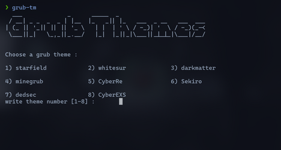

<h1 align="center">Grub Theme Manager</h1>

## What is Grub Theme Manager ?

A program written in Python, its goal is to manage GRUB themes.
The program can read the themes stored in themes directories, change grub config and install the theme.

<center>

</center>

## required packages

python : https://www.python.org/ <br>
python-pip : https://pypi.org/project/pip/ <br>
grub : use your package manager to install GRUB. <br>

> **Note**: Before you start downloading the project, you need to make sure that you have the required packages installed in your system.

## Setup

### Download the project

```
$ git clone https://github.com/KHLALA-Gh/grub-themes-manager.git
```

### installation

cd to the repo :

```
$ cd ./grub-themes-manager
```

run install.sh script

```
$ sudo ./install.sh
```

### post installation

run Grub Themes Manager :

```
$ grub-tm
```

## Update

To update the package just pull the changes from the repo and run the install script :

```
$ git pull && sudo ./install.sh
```

## Usage

```
grub-tm -h
```

Will give all options for this tool.

```
grub-tm
```

Reads the themes directory specified in the configs (by default `/usr/share/grub/themes`)
then waits for user input to choose a theme and install it.

```
grub-tm -i THEME_DIR
```

install the specified theme directly.
example : `grub-tm -i ~/Downloads/my-theme`

## Issues

### The program doesn't detect all my themes.

Grub Theme Manager searches for themes by default in this directory `/usr/share/grub/themes`. If you store your GRUB themes in another path you can add it to the configs.

```
grub-tm -c
```

To open config file.

```ini
[DEFAULT]
themes_dirs=[
    "/boot/grub/themes",
    "/usr/share/grub/themes",
    # add your path here.
    "/your/themes/path"
    ]
...
```

> **Note** : A GRUB theme should have `theme.txt` file at its rout level.

### When I run `grub-tm` i get `[  ERROR  ] config file does not exist './config.ini'.`

If you encounter an error indicating that the `./config.ini` file doesn't exist, that means your config file is missing.
To fix this run `grub-tm -g` to generate new config file.

### When I run `grub-tm` i get `KeyError` when parsing the config file

If you got any `KeyError` when parsing the config file,that probably means you have a missing property in the config file.You can know this missing property by reading the error.For example `KeyError 'grub_cfg'` means that `grub_cfg` is missing in the config file.To add it run `grub-tm -g` to generate new configs.

### None of these issues

If you encounter an issue not mentioned, please submit it in [issues](https://github.com/KHLALA-Gh/grub-themes-manager/issues)
